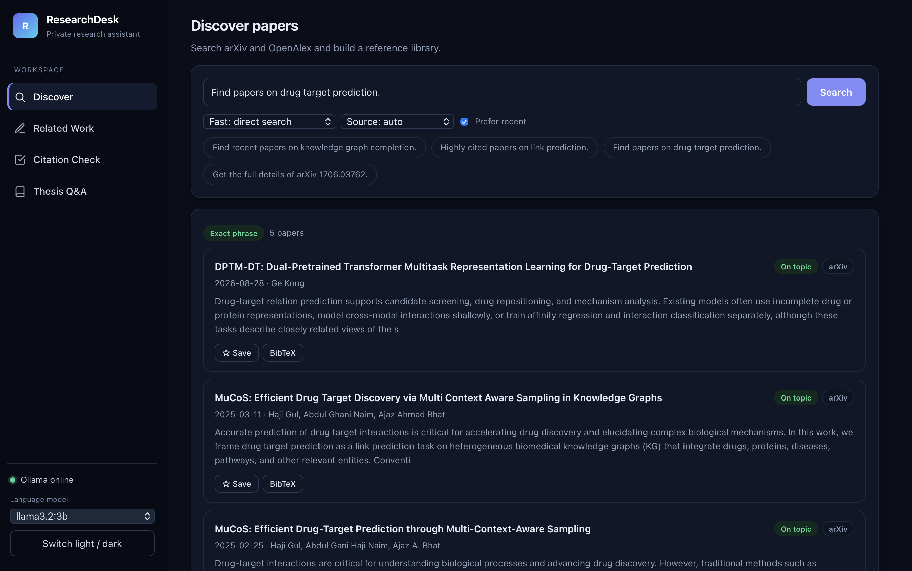
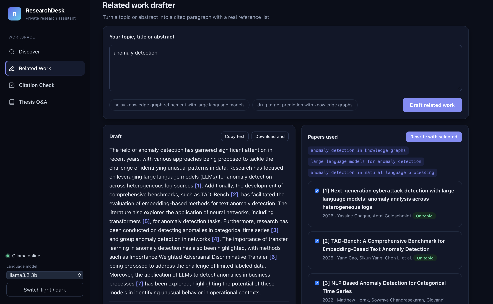
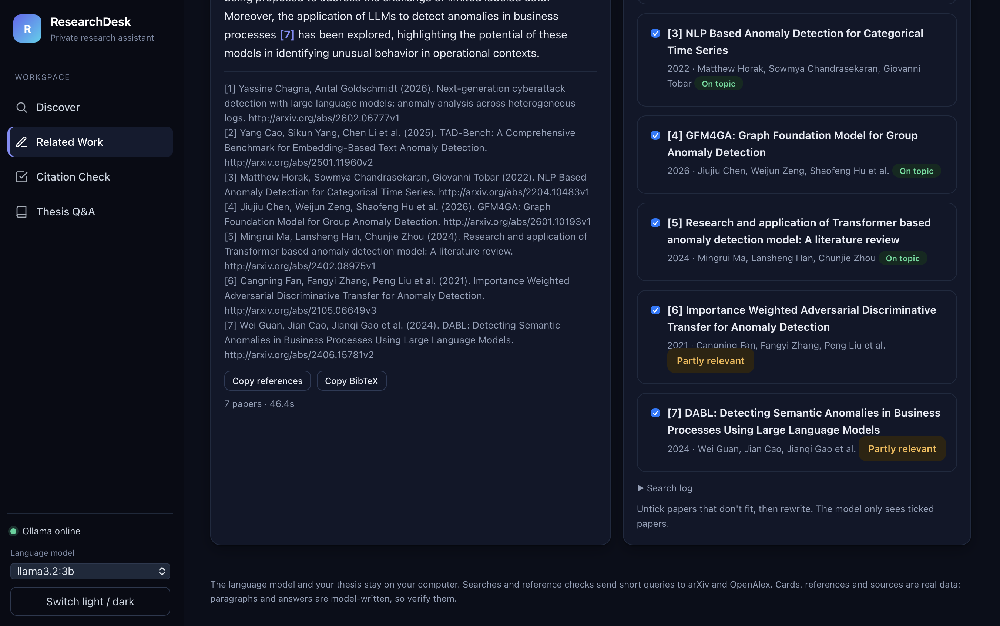
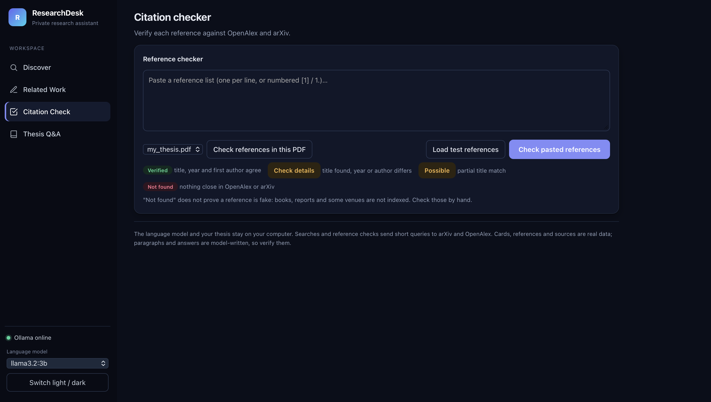

# ResearchDesk

A private, local research assistant. One web app with four tools: **paper discovery**, a **related-work drafter**, a **citation checker**, and **question answering over your own thesis or PDFs**.

The language model runs on your own computer through [Ollama](https://ollama.com). There are no API keys, no accounts, no subscriptions and no per-use cost.



## Contents

- [What it does](#what-it-does)
- [Screenshots](#screenshots)
- [Why local, free and private](#why-local-free-and-private)
- [Security and privacy: exactly what stays local](#security-and-privacy-exactly-what-stays-local)
- [How it works](#how-it-works)
- [Quick start](#quick-start)
- [Using each tool](#using-each-tool)
- [Project structure](#project-structure)
- [Configuration](#configuration)
- [Evaluation](#evaluation)
- [Limitations](#limitations)
- [Roadmap](#roadmap)
- [Author](#author) · [License](#license)

## What it does

| Tool | What you give it | What you get |
|---|---|---|
| **Discover** | A topic, a question, or an arXiv ID | Verified paper cards from arXiv and OpenAlex (authors, date, abstract, citation counts), a short AI overview, a saved library, BibTeX and CSV export |
| **Related Work** | A topic, title or abstract | A cited related-work paragraph with a reference list built from real arXiv data. Untick papers that do not fit and rewrite |
| **Citation Check** | A pasted reference list, or the bibliography of a PDF | Each reference marked Verified, Check details, Possible match or Not found, with the matched record and a CSV export |
| **Thesis Q&A** | A question about your PDF | An answer based only on retrieved passages, with file and page citations you can click |

## Screenshots

### Discover
Search arXiv and OpenAlex, get verified paper cards, save papers to a library and export BibTeX or CSV.


### Related Work: draft
Paste a topic or abstract. The agent plans its own searches, then writes a cited paragraph. Clicking a citation like [3] jumps to that paper.



### Related Work: papers and references
The reference list is built from real arXiv data. Untick papers that do not fit and rewrite using only the ticked ones.



### Citation Check
Each reference is checked against OpenAlex and arXiv and marked Verified, Check details, Possible match or Not found.



### Thesis Q&A
Ask questions about your own PDF and get answers with clickable page sources.

<!-- Upload a screenshot (for example Thesis_QA.png), then delete these two comment lines to show it:

-->

## Why local, free and private

- **No cost.** The model is an open model run by Ollama. There is no API key, no billing and no usage limit.
- **Your documents stay on your machine.** Your thesis is read, split into passages, embedded and searched entirely locally. The text of your PDF is never sent to an AI company or to any server.
- **Works for unpublished research.** You can paste an unpublished abstract or load a private manuscript without uploading it to a cloud AI service.
- **Real references.** Titles, authors, years and links come from arXiv and OpenAlex, not from the language model, so the reference lists cannot contain invented papers.
- **Transparent.** Search logs show what was queried, match badges say how a result was found (exact phrase, relaxed, broad, fallback), and invented citation numbers are flagged.
- **Open and hackable.** A handful of small Python files and a single HTML page. No build step and almost no dependencies.

## Security and privacy: exactly what stays local

Local does not mean fully offline, so here is the precise picture.

**Stays on your computer**

- The language model and all text generation (Ollama).
- The embedding model and the search over your thesis.
- Your thesis PDF and its saved index (`.cache/`).
- Your saved library, theme and settings (stored in your browser's local storage).

**Sent over the internet**

| Feature | What is sent | To whom |
|---|---|---|
| Discover | Short search phrases extracted from your query | arXiv, OpenAlex |
| Related Work | Short search phrases proposed by the local model, or keywords from your text if the first search finds nothing | arXiv |
| Citation Check | The text of each reference you check (pasted or read from the PDF's bibliography) | OpenAlex, and arXiv when a reference contains an arXiv ID |
| Optional | The email in `SCHOLAR_EMAIL`, as a contact address | OpenAlex |
| One-time setup | Model downloads | Ollama's servers |

Your thesis body text, your abstract text and your questions to Thesis Q&A are **not** sent anywhere. Only bibliography entries leave your machine, and only when you run a citation check.

**Design choices that protect you**

- The server binds to `127.0.0.1`, so only your own computer can reach it. Nothing is exposed to your network or the internet by default.
- There is no telemetry, analytics or account system.
- Reference lists and sources are built from real data, so a hallucinating model cannot invent a citation.

**What it does not do**

- **There is no login.** Anyone who can reach the server can use it. Do not expose it to the internet or port-forward it. The `--lan` option in the older `server.py` removes the localhost-only protection, so avoid it on networks you do not trust.
- **Local files are not encrypted.** The index in `.cache/` contains embeddings of your thesis text. Treat it like the thesis itself, and keep `thesis/` and `.cache/` out of Git.
- **It is not an audited security product.** If you handle confidential client documents, get a written agreement and check the data protection rules that apply to you first.

## How it works

```
Discover
 query --> router (rules or LLM) --> arXiv / OpenAlex --> paper cards --> short streamed overview

Related Work
 abstract --> LLM plans 3 search phrases --> arXiv --> dedupe + rank --> LLM writes paragraph
          --> Python builds references from real data, flags citation numbers that do not exist

Citation Check
 reference --> arXiv ID? DOI? --> OpenAlex search --> best match --> compare title, year, first author
          --> Verified / Check details / Possible / Not found

Thesis Q&A
 PDF --> pages --> chunks --> local embeddings --> saved index (built once)
 question --> embed --> top 5 passages --> LLM answers only from them --> clickable [n] page sources
```

The central design rule is the same everywhere: **the model writes prose, and Python supplies the facts.** The model never types reference lists, links or page numbers.

### The four parts in detail

**Discover.** Two modes. *Fast* uses a rule-based router to pick the tool and query, then streams a short overview. *Agent* lets the model choose the tool itself and handles follow-ups such as "the second paper". Searches try an exact phrase first, then a relaxed phrase, then a broad keyword match, and the badge always says which one matched. Two-concept questions ("A with B") are split so both concepts must appear. "Highly cited" queries fetch a relevance-ranked pool from OpenAlex and sort it by citations in Python.

**Related Work.** The model proposes three search phrases (abbreviations expanded, for example "KG" becomes "knowledge graph"). Results are deduplicated and weak matches ranked last. The model sees only abstract snippets, writes 150 to 200 words citing `[1]`, `[2]`, and the app checks that every cited number exists. You can untick papers and rewrite.

**Citation Check.** For each reference it tries an arXiv ID, then a DOI, then a full-text OpenAlex search, then a guessed-title search. It keeps the best match and compares title, year (one year of tolerance for preprints) and first-author surname. It can read the bibliography section straight from a PDF.

**Thesis Q&A.** PDFs in `thesis/` are split into overlapping chunks, embedded with `nomic-embed-text`, and cached. A question is embedded, the five most similar passages are retrieved (with a small keyword bonus), and the model answers using only those. It replies "I could not find this in the thesis" when the passages do not contain the answer. The index rebuilds automatically when the PDF changes.

## Quick start

**Requirements:** Python 3.9+ and [Ollama](https://ollama.com/download).

```bash
git clone https://github.com/hajigul/Scholar-Agent.git
cd Scholar-Agent

python3 -m venv agent-env
source agent-env/bin/activate        # Windows: agent-env\Scripts\activate
pip install -r requirements.txt

ollama pull llama3.2:3b              # language model (about 2 GB)
ollama pull nomic-embed-text         # embedding model (about 270 MB), needed for Thesis Q&A

mkdir -p thesis                      # put your PDF(s) in this folder
python suite_server.py
```

Keep the Ollama app running. The app opens at http://127.0.0.1:8003. On first start it builds the thesis index in the background, which takes a few minutes. The other tools work meanwhile.

If a pip download times out on a slow connection, use `pip install --resume-retries 5 --default-timeout 100 -r requirements.txt`.

## Using each tool

**Discover.** Type a topic or an arXiv ID, or click an example. Choose Fast or Agent mode, a source, and optionally "Prefer recent". Save papers to the library and export it as BibTeX or CSV.

**Related Work.** Paste an abstract or topic and click *Draft related work*. Click a citation like `[3]` to jump to that paper. Untick papers that do not fit and click *Rewrite with selected*. Copy the text, references or BibTeX, or download Markdown.

**Citation Check.** Paste references (one per line or numbered), or pick a PDF and check its bibliography. Filter by status and export CSV. "Load test references" fills in a sample with one deliberately wrong year and one invented reference, so you can see how each status looks.

**Thesis Q&A.** Ask a question and read the answer with its numbered sources. Click `[1]` to highlight the matching passage, then open that page in your PDF and confirm. Use *Rebuild index* after changing PDFs.

## Project structure

```
Scholar-Agent/
├── suite_server.py   # ResearchDesk server: one local web server for all four tools
├── suite.html        # ResearchDesk front end
├── tools.py          # arXiv + OpenAlex search, paper details, caching, request pacing
├── agent.py          # Discover engine: fast router, agent loop, streaming
├── related_work.py   # Related Work engine: query planning, drafting, checks
├── citecheck.py      # Citation checker: reference parsing and matching
├── thesis_qa.py      # Thesis Q&A: chunking, embeddings, retrieval, answering
├── config.py         # settings (model, port, cache lifetime)
├── eval.py           # evaluation suite for Discover
├── requirements.txt
│
├── server.py + index.html     # earlier standalone ScholarAgent app
├── rw_server.py + rw.html     # earlier standalone Related Work app
├── run.sh                     # setup helper for the earlier apps
│
├── *.png             # screenshots used in this README
├── thesis/           # YOUR PDFs (git-ignored, never uploaded)
└── .cache/           # search cache and thesis index (git-ignored)
```

## Configuration

| Variable | Default | Purpose |
|---|---|---|
| `SCHOLAR_MODEL` | `llama3.2:3b` | Ollama model for writing and answering |
| `SCHOLAR_PORT` | `8000` | Port for the earlier `server.py` |
| `SCHOLAR_EMAIL` | empty | Optional contact email sent to OpenAlex; it serves identified clients more reliably |

Cache lifetime and model keep-alive are in `config.py`. Run on another port with `python suite_server.py 8010`. A larger model such as `llama3.1:8b` usually writes and answers better but is slower and needs more memory.

## Evaluation

Discover has a 13-case test suite (`eval.py`) measuring pass rate, right tool called, keyword precision, `sort=date` use, an expected-paper check, invented IDs, and latency. Searches are not cached during evaluation, so timings are honest.

```bash
python eval.py --limit 3                 # quick check
python eval.py --mode both               # fast vs agent
python eval.py --score FILE_labels.csv   # score your hand labels
```

Results on the built-in set (`llama3.2:3b`, Apple M1 Pro):

| | Fast mode | Agent mode |
|---|---|---|
| Pass rate | 13/13 | 13/13 |
| Mean keyword precision | 0.978 | 0.978 |
| Invented IDs | 0/13 | 0/13 |
| Mean latency | 4.3 s | 5.3 s |

An earlier run, before fixes to query handling and citation-sorted search, scored 11/13 (fast) and 10/13 (agent).

**Read these numbers with care.** The author wrote the test set and tuned the code against its failures, so the scores are optimistic and show that known bugs are fixed, not that the tool generalizes. Keyword precision only checks that topic words appear, and 13 cases from a single run cannot support claims about small differences. Hand-labeled relevance (`_labels.csv` plus `--score`) is the stronger measure.

**Not yet evaluated:** the Related Work drafter, the Citation Checker and Thesis Q&A have no formal evaluation. A planned test for the checker is to take real references, corrupt some (change years, swap title words), invent others, and measure how many bad ones are flagged and how many real ones are wrongly not verified.

## Limitations

- **Model-written text can be wrong.** A small local model can overstate a paper's claims or misread a passage. Cards, references and sources are real data. Paragraphs and answers are not, so verify them.
- **Related Work sees abstracts only**, never full texts, and searches arXiv only. Journal papers not on arXiv will be missing.
- **"Not found" does not mean "fake".** Books, theses, reports and some venues are missing from OpenAlex. The checker also cannot catch wrong pages, wrong venues or wrong middle authors.
- **PDF reference parsing is heuristic.** Bibliography formats vary, so check the first rows against your PDF before trusting a summary.
- **Thesis Q&A limits.** Tables, equations and figures extract badly, scanned PDFs need OCR (not included), each question is answered independently, and page numbers are PDF positions, which can differ from printed page numbers.
- **"On topic" is a keyword check**, not a judgment of true relevance.
- **"Most cited" means most cited among the best text matches**, not among all papers on the topic.
- **One task at a time**, to avoid overloading a laptop model. arXiv requests are paced 3 seconds apart, as its API terms ask.

## Roadmap

- Formal evaluation of Related Work, Citation Check and Thesis Q&A with hand-labeled data
- OCR support for scanned PDFs
- Conversation memory for Thesis Q&A follow-ups
- Search OpenAlex in the Related Work tool
- Knowledge-graph question answering over local triples
- Optional password protection for shared use

## Author

**Haji Gul**, PhD (AI), Universiti Brunei Darussalam.
Research interests: knowledge graph completion, NLP, link prediction, LLM-augmented graph reasoning, Transformers, GNN, Complex Network, Community Detection.

GitHub: [@hajigul](https://github.com/hajigul)

## License

MIT License. See `LICENSE`.

## Acknowledgments

[Ollama](https://ollama.com), the [arXiv API](https://info.arxiv.org/help/api/index.html), [OpenAlex](https://openalex.org), and [pypdf](https://pypdf.readthedocs.io).
